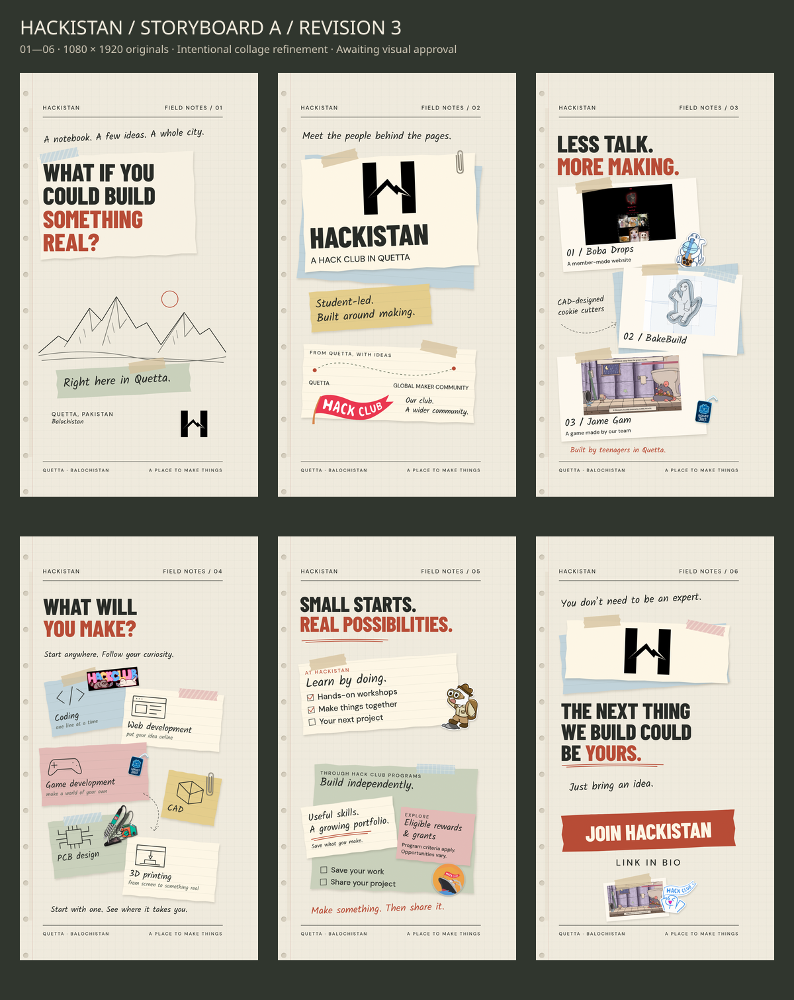
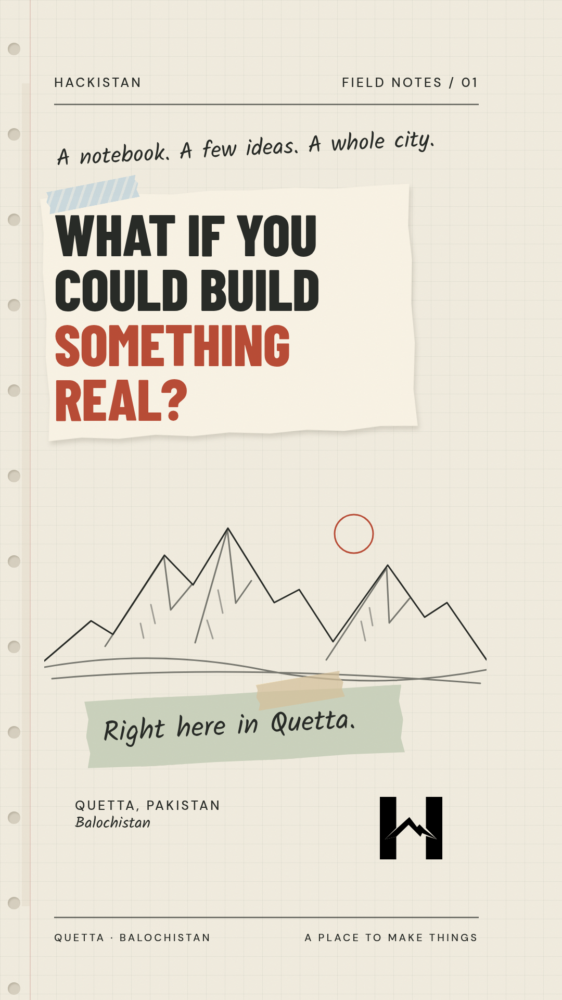
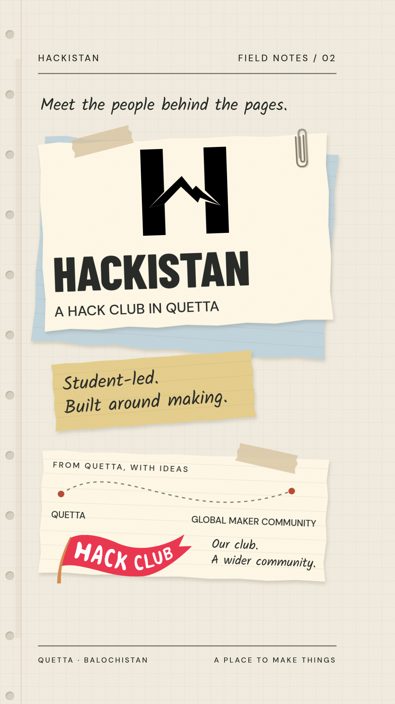
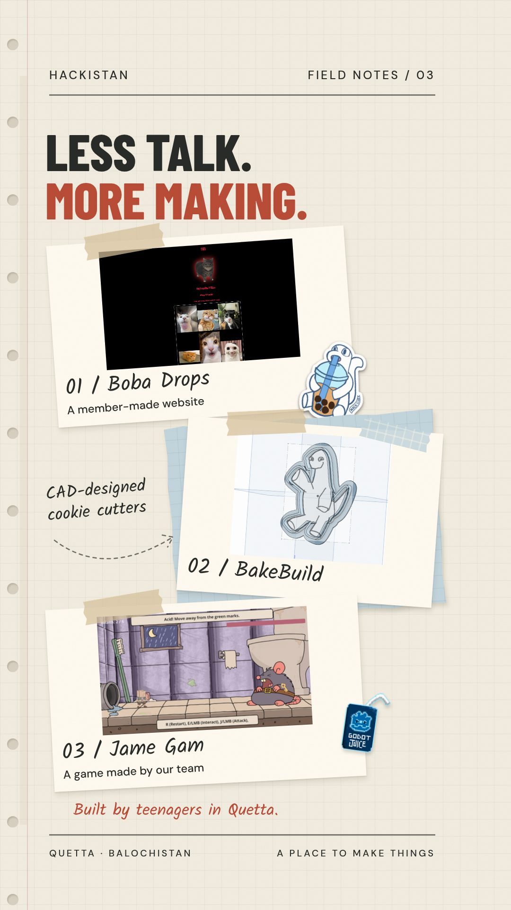
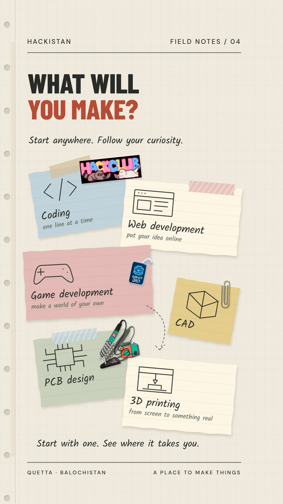
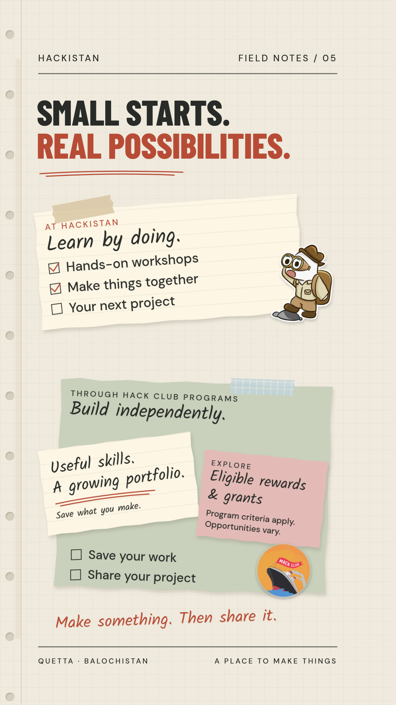
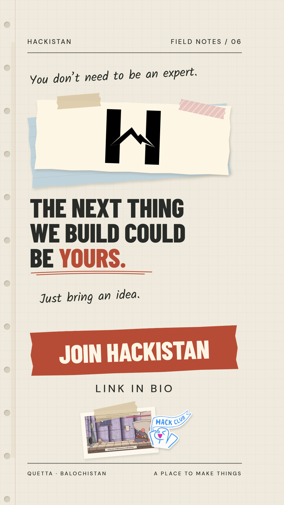

# Hackistan · Phase A · Revision 3

Refined for intentional composition: removed filler and repeated tabs, anchored tape to objects, tied stickers to their subjects, and simplified the opening and closing.

Six static pages rendered at **1080 × 1920** using Remotion and installed Chromium. No animation or final MP4 has been produced. Open any image below in GitHub to inspect it; use GitHub's download button for the original PNG.

## 01 · Opening the notebook · 0–7s

## 02 · Meet Hackistan · 7–15s

## 03 · Real projects · 15–28s

## 04 · What you can create · 28–40s

## 05 · Opportunities · 40–52s

## 06 · Join Hackistan · 52–60s

**Approval checkpoint:** review the typography, paper aesthetic, layouts and authentic asset placements. Phase B starts only after your approval.

[Previous storyboard for comparison](https://github.com/WockoPayaz/hackistan-intro-reel/blob/0f251a4582c08db13d5d1c41d04560cae2389b8f/output/storyboards/contact-sheet.png)
